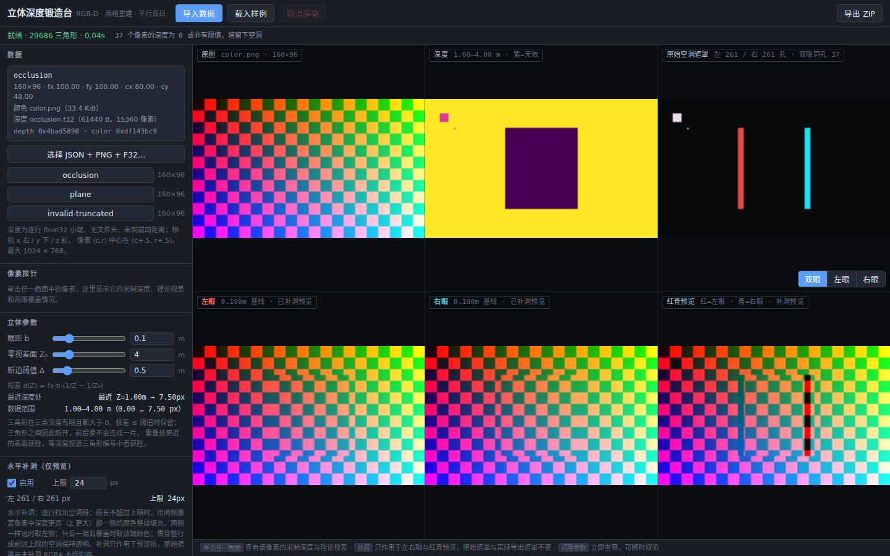
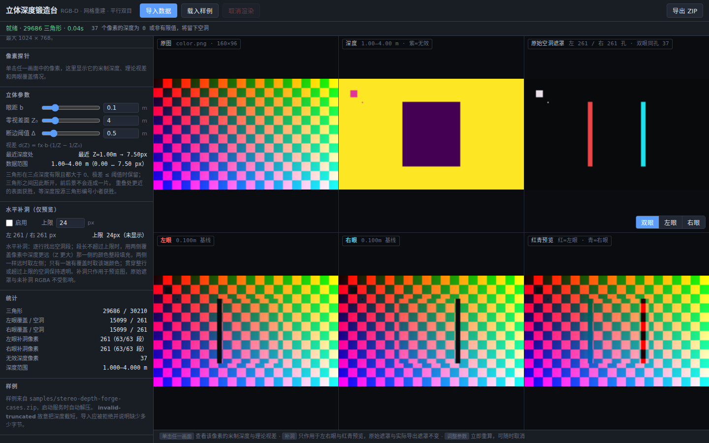

# 立体深度锻造台

展品照片 + 米制深度 → 左右眼立体画面。直接把像素水平挪开会把前后景粘在一起，
并在两眼露出不同的空洞；这里先把深度重建成**带断边的三角形网格**，再按平行双目
（离轴投影）光栅化两只眼，用一个深度缓冲决定前后遮挡。

- 纯前端，无构建步骤、无第三方运行时依赖；页面不加载任何网络资源。
- 渲染跑在 Web Worker 里，按时间片让出主线程；改参数会立刻重算，可随时「取消渲染」。
- 本地服务只依赖 Python 3 标准库，仅用于把页面和样例发给浏览器。





（图为 occlusion 样例：前景方块 1 m、背景 4 m、Z₀ = 4 m。前景向两侧各挪
`fx·b/2·(1/1 − 1/4)` ≈ 3.75 px，背后露出 4 px 宽的背景空洞；左眼在方块左侧、
右眼在右侧，两张遮罩因此不同。补洞开启时预览被填成背景色，未补洞导出不受影响。）

## 启动

```bash
python3 server.py                 # 默认 http://localhost:8000
python3 server.py --port 8123     # 换端口
```

Windows 浏览器打开 `http://localhost:8000` 即可（WSL2 会转发 localhost；服务默认监听
`0.0.0.0`）。不需要 Docker，也不需要安装任何 Python 包。

> 页面使用 ES 模块，浏览器不允许从 `file://` 加载模块脚本，所以请通过上面的本地服务
> 打开，而不是直接双击 `index.html`。直接双击时页面会提示这一点。

样例是 `samples/stereo-depth-forge-cases.zip`，服务启动时自动解压到
`samples/extracted/`（已存在则不覆盖）。也可以手动解压：

```bash
unzip -o samples/stereo-depth-forge-cases.zip -d samples/extracted
```

## 使用

1. **载入数据**：点「载入样例」选一个样例，或「导入数据」同时选择 `JSON` + 颜色 `PNG` +
   深度 `.f32`（也可以把三个文件一起拖进页面）。文件名按 JSON 里的 `color` / `depth`
   匹配；只选 JSON 时会提示还缺哪个文件。
2. **参数**：眼距 `b`、零视差面 `Z₀`、断边阈值 `Δ` 都可拖滑块或直接输入。
   右侧实时显示 `d(Z) = fx·b·(1/Z − 1/Z₀)` 在最近/最远深度上的取值。
   参数非法（例如负眼距）会被拒绝并提示，不会打断当前画面。
3. **六个联动画面**：原图、深度（viridis 近→远，洋红 = 0 或非有限）、原始空洞遮罩、
   左眼、右眼、红青预览。遮罩面板可在「双眼 / 左眼 / 右眼」间切换：双眼视图里
   红 = 仅左眼有孔、青 = 仅右眼有孔、白 = 两眼都是孔。
4. **像素探针**：单击任一画面任意位置，右上角面板给出该像素的 `(c, r)`、像素中心、
   米制深度、理论视差 `d(Z)`、左右眼各自的位移，以及该像素在两眼是「覆盖」还是「空洞」。
5. **水平补洞（仅预览）**：默认开启，可设段长上限（px）。补洞只改变左右眼与红青预览的
   显示，**原始遮罩与未补洞结果不受影响**；导出的补洞图与未补洞图始终分开。具体策略
   见下文与界面说明。
6. **导出 ZIP**：`left.png` / `right.png`（未补洞 RGBA）、`left-filled.png` /
   `right-filled.png`（补洞预览）、`left-mask.png` / `right-mask.png`（8 位灰度原始
   遮罩）、`anaglyph.png`、`params.json`、`README.txt`。
7. **取消**：渲染过程中「取消渲染」始终可按，取消后画面保留上一次完成的完整结果。

## 规则（实现契约）

### 数据格式

JSON（样例即此格式）：

```json
{
  "width": 160, "height": 96,
  "fx": 100, "fy": 100, "cx": 80.0, "cy": 48.0,
  "color": "color.png",
  "depth": "occlusion.f32",
  "eye_distance": 0.1, "zero_plane": 4, "jump": 0.5
}
```

- 深度是**逐行、float32 小端、无文件头**的数组，长度必须正好 `width × height × 4` 字节。
  多一字节或少一字节都会被拒绝，报错里写明缺/多多少字节。
- 深度单位是米，`Z` 为相机前向距离；相机 `x` 向右、`y` 向下、`z` 向前。
- 像素 `(c, r)` 的中心在 `(c + 0.5, r + 0.5)`。
- `X = (c + 0.5 − cx)·Z / fx`，`Y = (r + 0.5 − cy)·Z / fy`。
- 左右眼 `eyeX` 分别为 `−b/2` 与 `+b/2`；
  `u = fx·(X − eyeX)/Z + cx + fx·eyeX/Z₀`，`v = fy·Y/Z + cy`。
  代入 `X`、`Y` 后，网格顶点只做水平位移 `fx·eyeX·(1/Z₀ − 1/Z)`，`v` 不变。
- 两眼视差 `d(Z) = fx·b·(1/Z − 1/Z₀)`（像素）。`Z < Z₀` 为正（交叉视差），
  `Z = Z₀` 为 0，`Z > Z₀` 为负。
- 宽度上限 1024、高度上限 768；颜色 PNG 必须是 8 或 16 位、非隔行的
  `RGB`/`RGBA`/灰度/调色板图，尺寸必须与 JSON 一致。

### 网格与断边

每个源像素格 `(c, r)` 使用角点 `00=(c,r)`、`10=(c+1,r)`、`11=(c+1,r+1)`、`01=(c,r+1)`，
组成两个三角形 `[00, 10, 11]` 与 `[00, 11, 01]`。一个三角形只有在**三个顶点深度都有限、
都大于 0、且极差 ≤ Δ** 时才保留。0、负数、NaN、Infinity 的像素因此既不会生成三角形，
也不会被当作 0 米表面。

三角形编号按行优先的格子顺序递增（每个格子先 `[00,10,11]` 后 `[00,11,01]`），这个顺序
就是深度相同时的裁决顺序。

### 光栅化

在输出像素中心做半空间测试，带深度缓冲：**正值更小者获胜**；深度相等时**源三角形编号
更小者获胜**。边缘判定是闭区间（像素中心正好落在边上算覆盖），并带 `1e-7` 的数值余量，
避免浮点噪声让轮廓线随机抖动。颜色在原图对应源坐标处**双线性**采样。背景没有覆盖的
像素为透明；遮罩 `255 = 空洞`、`0 = 覆盖`，只由覆盖决定——纯黑像素仍算覆盖。

### 水平补洞（仅预览）

逐行扫描空洞段：段长不超过上限时，用两侧覆盖像素中**深度更远（Z 更大）**那一侧的
颜色整段填充，两侧一样远取左侧；只有一端有覆盖时取该端；贯穿整行或超过上限的段保持
透明。补洞只写入预览副本：原始遮罩、未补洞 RGBA 与导出文件都不变。

## 导出

ZIP 内文件：

| 文件 | 内容 |
| --- | --- |
| `left.png` / `right.png` | 未补洞左/右眼，8 位 RGBA，直通 alpha（覆盖 255，空洞 0） |
| `left-filled.png` / `right-filled.png` | 水平补洞预览（仅预览，不替代未补洞结果） |
| `left-mask.png` / `right-mask.png` | 原始空洞遮罩，8 位灰度，255 = 空洞，0 = 覆盖 |
| `anaglyph.png` | 未补洞左右眼的红青合成（红 = 左，青 = 右） |
| `params.json` | 完整参数、源数据指纹、派生量、渲染规则与各文件说明 |
| `README.txt` | 同样内容的纯文本摘要 |

`params.json` 里记录 `fx, fy, cx, cy`、眼距、零视差面、断边阈值、补洞开关与上限、
补洞策略原文、`eyeX`、视差公式、最近/最远米制视差、三角形数、两眼空洞与补洞统计、
输入文件长度与 FNV-1a 指纹。导出的 PNG 都是 8 位、filter 0 行、无附加块。

## 测试

```bash
node --test tests/core.test.mjs tests/png.test.mjs tests/zip.test.mjs tests/params.test.mjs
node tests/e2e.mjs      # Playwright；未安装时自动跳过
```

- `tests/core.test.mjs`：投影/视差闭式、网格断边、光栅化（含与
  `tests/fixtures/reference_renderer.py` 这个独立 Python 实现的逐像素对照）、
  补洞规则、验证与取消。
- `tests/png.test.mjs` / `tests/zip.test.mjs`：编解码往返、截断与 CRC 拒绝、系统 `unzip` 互通。
- `tests/params.test.mjs`：几何键、参数快照与导出 JSON。
- `tests/e2e.mjs`：真实浏览器里跑样例、导入被拒、参数改算、补洞开关、探针、导出 ZIP
  的实际字节校验、1024×768 取消路径、超尺寸拒绝。

## 文件

```
server.py                    本地静态服务 + 样例解压（Python 标准库）
app/index.html               页面布局与样式
app/js/core.js               投影、网格、光栅化、补洞、合成（纯函数）
app/js/png.js                PNG 解码/编码（DecompressionStream / CompressionStream）
app/js/zip.js                ZIP 写入/读取（raw deflate）
app/js/params.js             参数快照与导出 JSON
app/js/render-worker.js      时间片渲染、几何缓存、取消
app/js/app.js                页面控制器
tests/                       单元与 e2e 测试、独立参考实现与对照 fixture
```
