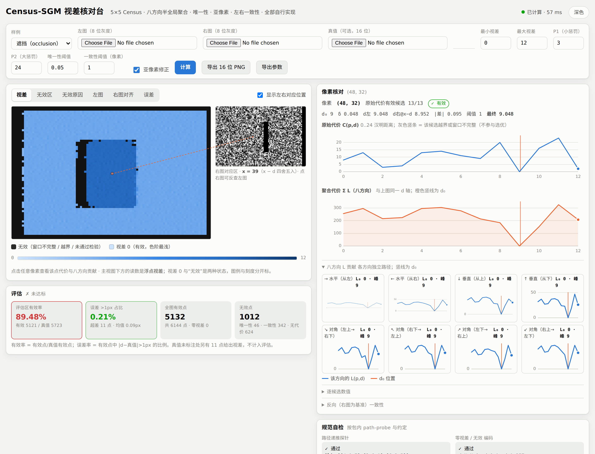

# Census-SGM 视差核对台

双目图像的**视差验证台**：5×5 Census 变换、八方向半全局聚合（SGM）、唯一性检验、
亚像素修正、左右一致性检查全部在本地自行实现，不调用任何现成的双目 / SGM / 匹配接口，
也不引入第三方 JS 包。

重复纹理会选错对应点，遮挡处常把左右检查的符号弄反——这个页面就是为了逐项核对：
**每个像素的原始代价、八方向 L 贡献、聚合曲线、反向一致性**都能点开来看，
图边与遮挡靠“无效”明确标出，不会用补零凑出虚假深度。



## 快速开始

```bash
./scripts/start.sh          # 默认 http://localhost:8000/
./scripts/start.sh 9000     # 指定端口
```

服务只托管 `src/` 下的静态文件（Python 标准库，`-I` 隔离模式），页面全程离线可用。

## 规范（严格按样例包 README.txt）

- **正视差 d**：左图 `(x,y)` ↔ 右图 `(x−d,y)`，候选 d 为 `[min_disparity, max_disparity]` 内的整数（限定 0..63）。
- **Census**：5×5 窗口，行优先跳过中心；邻值**严格小于**中心置 1；仅完整窗口有效；
  代价为 24 位汉明距离；窗口越界（任一侧图的窗口不完整）代价恒为 `1000000`。
- **八方向聚合**：水平 ±、垂直 ±、两组对角线 ±，共八个单位方向。每方向

  ```
  L(p,d) = C(p,d) + min(L(prev,d), L(prev,d−1)+P1, L(prev,d+1)+P1, min_k L(prev,k)+P2) − min_k L(prev,k)
  ```

  路径起点 `L = C`；**不存在的 d 候选项**（越出区间的 d±1）不参与 min。`S = Σ 八方向 L`，不再减重复 C。要求 `P2 > P1 ≥ 0`。
- **选优**：最小 S 并列取小 d；**只在有效原始代价中选最优**（越界/窗口不完整的候选不参与）。
- **唯一性**：排除 `|d−d0|≤1` 后的次优 S2，`(S2−S0)/max(S0,1) ≥ ratio` 才通过；无次优则通过。
- **亚像素**：`δ = (S(d−1) − S(d+1)) / (2·(S(d−1) − 2S(d) + S(d+1)))`，夹到 `[−.5,.5]`；
  候选不全（d0 在区间端点）或分母 ≤ 0 时 `δ = 0`。
- **左右一致性**：反向以右图为基准，右图 `(x,y)` 对应左图 `x+d`，视差仍为正数。
  在 `floor(x − d_left + .5)` 处读取反向视差，两者差不超过阈值才有效。**符号不能反**。
- **导出**：16 位灰度 PNG，`0` 为无效，其余为 `1 + floor(256·d + .5)`。
  **零视差编码为 1，与无效的 0 严格区分。**

## 页面功能

| 区域 | 内容 |
| --- | --- |
| 输入 | 导入已校正的同尺寸 8 位灰度左右 PNG（≤320×240），可选 16 位真值 PNG；内置常视差 / 遮挡两套样例 |
| 参数 | 视差区间（0..63）、P1/P2、唯一性阈值、一致性阈值、亚像素开关；改参数后提示需要重新计算 |
| 主视图 | 视差（单色蓝顺序色阶，0 与无效分开标）、无效区、无效原因（四色 + 文字）、左图、右图对齐、误差 |
| 联动 | 主视图旁显示右图对应区并高亮 `x − d`；虚线连接左右对应位置；点右图可反查左图 `x = floor(x_r + d_right + .5)` |
| 像素核对 | 选中像素的 `d₀ → δ → d_left → d_right@x−d → |差| → 阈值 → 最终` 链路；原始代价曲线、聚合代价曲线、八方向小多图、逐候选数值表、反向一致性 |
| 评估 | 导入真值后按包内约定统计有效率与 `|d−真值|>1px` 比例，达标（≥90% / ≤2%）给出标记 |
| 导出 | 16 位 PNG（内嵌参数块）+ 参数 / 统计 JSON |

键盘：选中画面后 `←/→/↑/↓` 移动一个像素，`Shift` 加速到 8 像素。

## 目录结构

```
src/index.html          页面（内联样式，无外部资源）
src/js/core.js          Census / 代价卷 / 八方向聚合 / WTA+唯一性+亚像素 / 左右一致性 / 评估 / 编码
src/js/png.js           纯 JS PNG 编解码（平台 DecompressionStream / CompressionStream，无第三方库）
src/js/worker.js        计算 Worker（保留代价卷与聚合卷，按需回放单像素）
src/js/viz.js           SVG 折线图 / 双图共享轴 / 小多图 / 直方图（含 hover tooltip）
src/js/app.js           主线程：导入、绘制、选择联动、导出、自检
src/js/samples.js       内置样例（base64）
scripts/serve.py        静态服务器（Python 标准库）
scripts/start.sh        启动脚本
scripts/selfcheck.sh    一键自检（单元 + 端到端）
tests/unit.mjs          Node 单元测试（算法 / 编码 / PNG）
tests/e2e.mjs           无头 Chrome 端到端测试（自带零依赖 CDP 客户端）
samples/extracted/      从 cases zip 提取的样例
```

## 测试

```bash
node tests/unit.mjs                      # 纯算法与编码
CHROME=/path/to/chrome node tests/e2e.mjs  # 真实浏览器渲染与交互
./scripts/selfcheck.sh                   # 两者都跑
```

单元测试覆盖：路径递推与 `path-probe.json` 一致、常视差有效率 100% / 误差 0%、
图边不补零、越界代价恒为 `INVALID_COST`、唯一性邻域排除、亚像素三种退化情形、
左右一致性方向、零视差/无效编码、PNG 16 位往返、检查台回放与存储曲线一致。

端到端测试覆盖：样例自动计算与达标、六种视图渲染、像素点选与右图反查、
导出 PNG 回读（16 位 / 0 与有效值并存 / 内嵌参数）、参数校验与重算、
遮挡样例、窄屏无横向溢出、无未捕获异常。

## 约定与边界

- **图边不补零**：5×5 窗口不完整的像素所有候选代价均为 `1000000`，直接判为“无有效原始代价”，
  不会输出深度。视差越界一侧同理。
- **遮挡不填深度**：遮挡区在左右一致性检查处被拒（反向视差与正向差异超过阈值），
  视图中显示为“无效 · 左右一致性未通过”，而不是被平滑或补零。
- **零视差 ≠ 无效**：视差 0 是合法有效值，导出为样本 1；无效导出为 0。
- **重复纹理**：唯一性检验排除 `|d−d0|≤1` 后仍要求次优差距，可抑制周期性纹理的误匹配；
  页面上可实时调阈值并观察代价曲线上的多峰。
